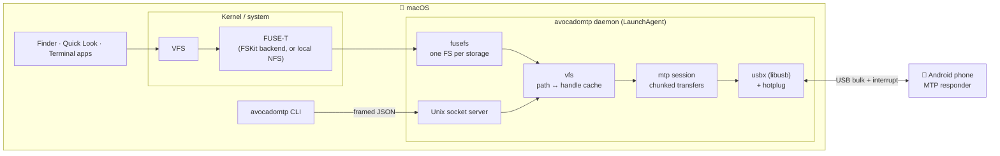
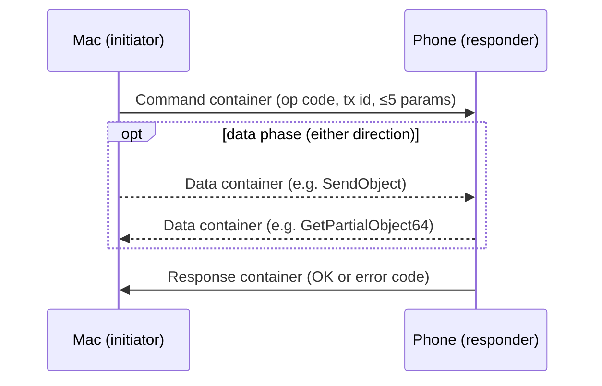
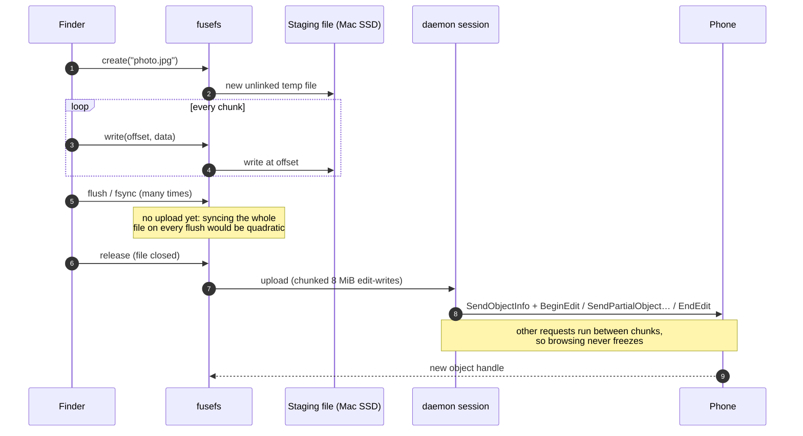
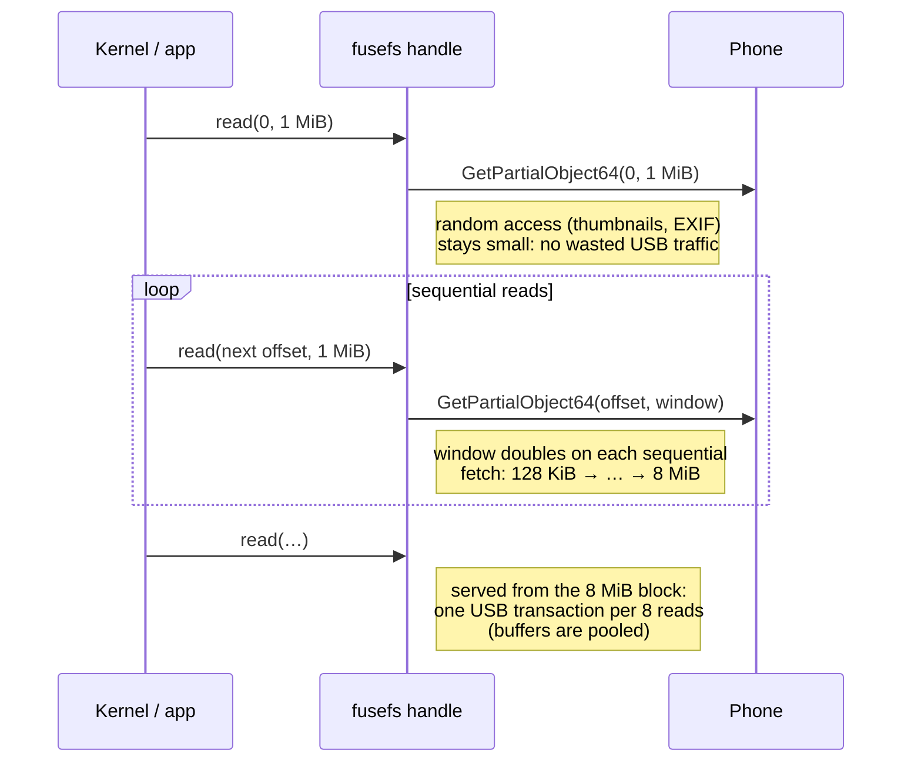
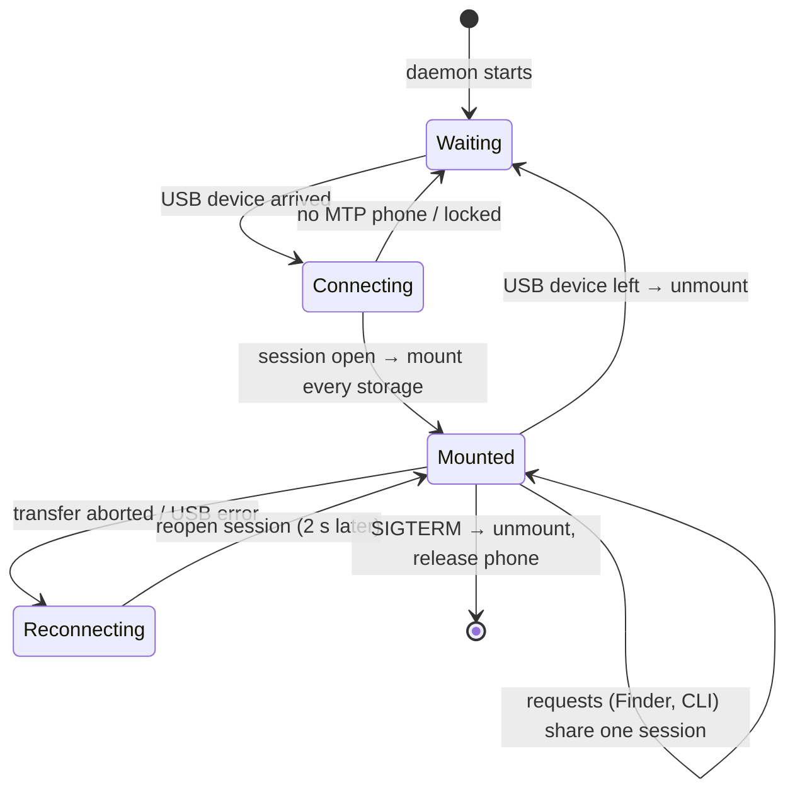
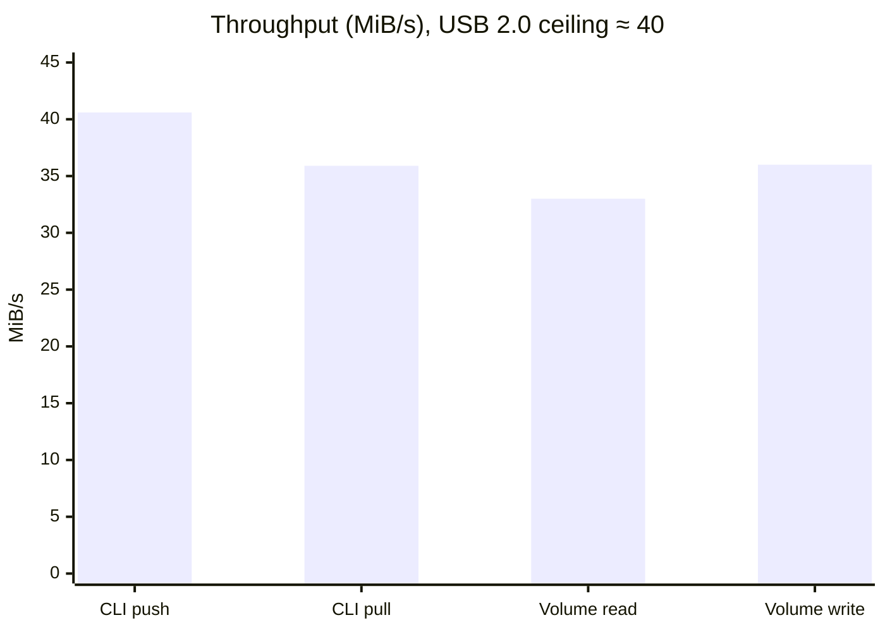
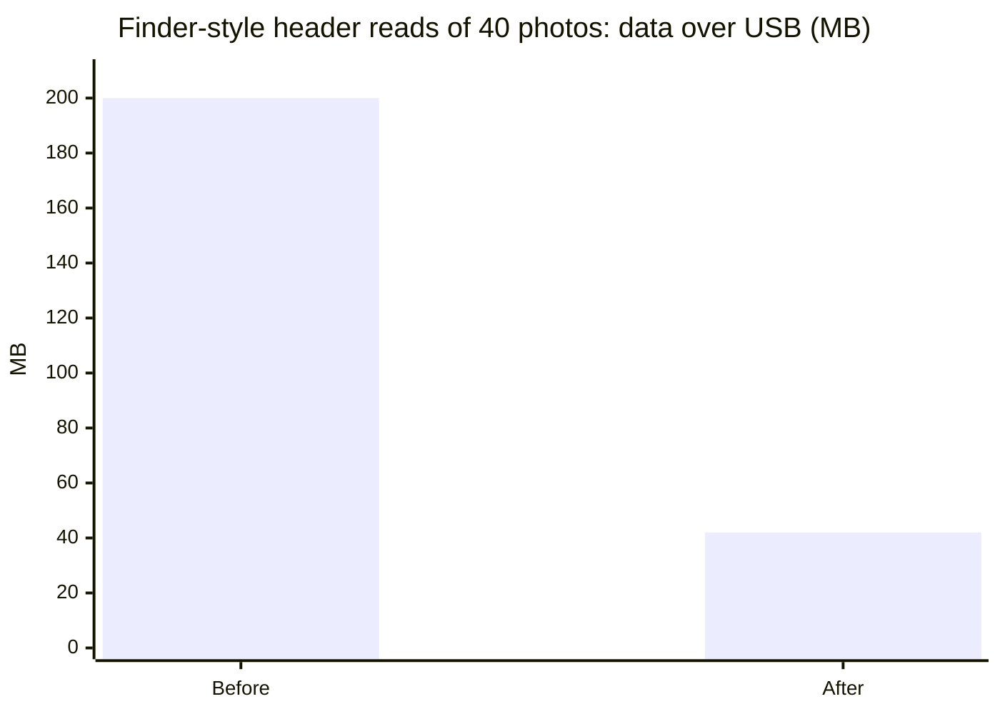

# 🥑 AvocadoMTP

**Android ↔ macOS file transfer over USB, the way Linux does it.**
Plug the phone in and its storage appears in Finder, with drag and drop, Quick Look and `cp`/`rsync`
from the terminal. No SD-card swapping, no kernel extensions, no paid apps.

> 📊 **Interactive version:** open [`docs/index.html`](docs/index.html) (or the project's GitHub Pages site)
> for clickable architecture diagrams, animated transfer flows and the performance dashboard.

| | |
|---|---|
| **Protocol** | MTP (Media Transfer Protocol), the PTP extension Android uses for USB file access |
| **How** | A user-space MTP stack on libusb (the approach OpenMTP and MacDroid take) |
| **Finder** | Each phone storage becomes its own disk, mounted through [FUSE-T](https://www.fuse-t.org/) |
| **Tested on** | macOS 26 (Apple Silicon) with a Retroid Pocket 6 (Android, 100 GB internal + 476 GB SD) |

---

## Contents

- [Quick start](#quick-start)
- [Demo](#demo)
- [How it works](#how-it-works)
- [Transfer flows](#transfer-flows)
- [Performance dashboard](#performance-dashboard)
- [CLI reference](#cli-reference)
- [Finder volumes](#finder-volumes)
- [Project layout](#project-layout)
- [Releasing](#releasing)
- [Troubleshooting](#troubleshooting)
- [Roadmap](#roadmap)

---

## Quick start

**One command** (macOS 14 or later, Apple Silicon or Intel):

```sh
curl -fsSL https://raw.githubusercontent.com/andymartinezot/avocadomtp/main/install.sh | bash
```

It downloads the latest [release](https://github.com/andymartinezot/avocadomtp/releases): the menu
bar app with the service inside. Then it:

- checks the download's sha256;
- installs [FUSE-T](https://www.fuse-t.org), with Homebrew if you have it (otherwise it gives you the
  link);
- puts `AvocadoMTP.app` in `/Applications` and starts the service.

No Xcode, Go or libusb needed. Run it again to update. You can also download `AvocadoMTP.zip` from the
releases page yourself: the app isn't notarized, so macOS asks once for **System Settings → Privacy &
Security → Open Anyway**.

> **What you're trusting:** releases are built by GitHub Actions from this repository and are ad-hoc
> signed (no paid Apple certificate). The installer downloads over HTTPS only and checks the sha256
> published with the release, which catches corrupted downloads; the trust root is GitHub and this
> repository. Prefer to check first? Read [`install.sh`](install.sh), or build from source below.

---

## Demo

A clean install end to end: the one command, enabling the FUSE-T FSKit extension in System
Settings, the menu bar app, and the phone connecting with each storage mounting as its own
Finder volume. Recorded on macOS 26 (Apple Silicon) with a Retroid Pocket 6.


▶ **[Same recording as video](https://github.com/andymartinezot/avocadomtp/blob/main/docs/avocadomtp-demo.mp4)** (44 s, sharper text and playback controls).

<details>
<summary><b>Other ways: from source, or building the app yourself</b></summary>

**From source** (Homebrew; the service, Finder volumes and CLI, without the menu bar app):

```sh
git clone https://github.com/andymartinezot/avocadomtp.git && cd avocadomtp
./install.sh --from-source        # or the same four steps by hand:
brew install go libusb            # build dependencies
brew install --cask fuse-t        # Finder volumes (free, no kernel extension)
go build -o bin/avocadomtp ./cmd/avocadomtp
./bin/avocadomtp daemon install      # start at login; mounts the phone in Finder
```

**Build the app yourself** (Xcode; no Apple account needed, the build is ad-hoc signed). The app
sets up the service on first launch:

```sh
brew install go libusb xcodegen && brew install --cask fuse-t
scripts/build-app.sh              # UNIVERSAL=1 for Apple Silicon + Intel
cp -R macos/build/Build/Products/Release/AvocadoMTP.app /Applications/ && open /Applications/AvocadoMTP.app
```

</details>

Then:

1. Unlock the phone, plug it in, and pick **File transfer** in its USB notification.
2. Turn on **System Settings → General → Login Items & Extensions → File System Extensions → fuse-t**
   so the volumes mount as local disks (otherwise FUSE-T falls back to a local NFS share).
3. Open Finder: the phone's storages appear under **Locations** (e.g. `Retroid Pocket 6`, `Retroid6`).

---

## How it works

macOS has no MTP stack, so Finder can't see Android phones. AvocadoMTP speaks MTP itself over libusb,
and a small background daemon owns the USB connection and serves both the Finder volumes and the CLI.



### Layers

| Layer | Package | What it does |
|---|---|---|
| USB | `internal/usbx` | Finds the MTP interface, claims it (stopping `ptpcamerad`), bulk I/O, USB hotplug events |
| Wire format | `internal/ptp` | Byte-level containers and datasets (DeviceInfo, StorageInfo, ObjectInfo, ObjectPropList) |
| Protocol | `internal/mtp` | Transactions (command → data → response), streaming, Android extensions, counters |
| Paths | `internal/vfs` | `/Storage/dir/file` ↔ object handles, TTL directory cache, Unicode-normalized lookups |
| Sharing | `internal/daemon` | One USB owner for every client; Unix-socket protocol; LaunchAgent install |
| Finder | `internal/fusefs` | FUSE file system per storage: read-ahead, write staging, macOS-metadata shadow store |
| Memory | `internal/bufpool` | Pooled transfer buffers (64 KiB–16 MiB) |
| Entry point | `cmd/avocadomtp` | CLI, interactive shell, `avocadomtp daemon` |

### One MTP transaction

Every operation is a command, an optional data phase and a response, on the USB bulk endpoints:



Files are **objects** identified by 32-bit handles inside **storages** (internal memory, SD card).
There are no paths in MTP; `vfs` builds them by listing folders.

---

## Transfer flows

### Copying a file **to** the phone (Finder drag and drop)

MTP cannot modify a file in place, so writes are staged on the Mac and uploaded once, when the file is closed.



Replacing an existing file uploads under a temporary name first, then swaps, so a failed upload never
destroys the original.

### Reading a file **from** the phone (adaptive read-ahead)



### Daemon lifecycle

The daemon wakes only on USB hotplug events: no polling, so the phone's MTP service can sleep.



---

## Performance dashboard

Measured on a MacBook (Apple Silicon, macOS 26) with a Retroid Pocket 6 over **USB 2.0 (480 Mb/s)**.
About 40 MiB/s is the practical MTP ceiling on that link.

### Throughput

| Transfer | Speed | Integrity |
|---|---|---|
| CLI push, 2 GiB | **40.6 MiB/s** | SHA-256 identical |
| CLI pull, 2 GiB (through daemon) | **35.9 MiB/s** | SHA-256 identical |
| Finder volume → Mac, 1 GiB | **33 MiB/s** | SHA-256 identical |
| Mac → Finder volume, 500 MB | **36 MiB/s** | SHA-256 identical |



### Optimization results

| Workload | Before | After | Change |
|---|---|---|---|
| Read 64 KiB headers of 40 photos (Finder thumbnails) | 6.79 s · 200 MB over USB | **2.33 s · 42 MB** | 3× faster, 5× less USB traffic |
| Copy 1 GiB from a volume | 2.8 s CPU + 1 GiB written to SSD | **1.9 s CPU, no SSD writes** | −32% CPU |
| Idle phone, MTP transactions per minute | ~20 (polling every 3 s) | **0** | phone can sleep |
| No phone connected | every USB device opened every 3 s | **nothing until a hotplug event** | no wakeups |
| Folder listing while a 2 GiB copy runs | 67 s (blocked) | **0.3–0.5 s** | chunked transfers |
| Daemon memory (idle / during 1 GiB copy) | | **≈10 MB / ≈36 MB RSS** | |



What made the difference:

- **Lazy write staging:** FUSE-T's FSKit backend opens every file read-write; files are now only
  downloaded for staging when the first write actually arrives.
- **Adaptive read-ahead:** starts at 128 KiB and doubles on sequential reads up to 8 MiB.
- **USB hotplug** instead of polling; a 60 s safety check only runs while no phone is connected.
- **Pooled buffers** and zero-copy partial reads.
- **Chunked transfers** (8 MiB) so one copy never blocks the other volume or the CLI.

---

## CLI reference

```sh
avocadomtp devices                                   # list connected MTP devices
avocadomtp info                                      # model, serial, storages, free space
avocadomtp ls -l "/Retroid Pocket 6/DCIM/Camera"
avocadomtp pull -r "/Retroid Pocket 6/DCIM/Camera" ~/Pictures/phone
avocadomtp push -r ~/Music "/Retroid6/Music"
avocadomtp mkdir -p "/Retroid6/Backups/2026"
avocadomtp mv "/Retroid6/a.txt" "/Retroid6/Backups/b.txt"
avocadomtp rm -r "/Retroid6/Old"
avocadomtp shell                                     # interactive: cd, ls, pull, push, lcd, lls …

avocadomtp watch                                  # live: phone, volumes, transfers, speed
avocadomtp eject Retroid6                         # unmount one volume (until mount/reconnect)
avocadomtp eject --all                            # unmount every volume (safe to unplug)
avocadomtp mount                                  # mount all volumes again
```

- Remote paths start with the storage name. The internal storage is named after the phone
  (`Retroid Pocket 6`); the phone's own description (`Internal shared storage`) works too.
- Flags may appear anywhere; use `--` before a path that starts with `-`. `-d SERIAL` picks a device.
- When the daemon runs, the CLI goes through it; `--direct` talks to USB instead.
- In the shell, Ctrl-C cancels a transfer and, at the prompt, quits.

### Background service (on / off)

The daemon runs as a LaunchAgent. You decide whether it runs, and whether it starts at login:

```sh
avocadomtp daemon install            # set up the service (copies the binary) and start it
avocadomtp daemon install --no-start # set it up without starting it now
avocadomtp version                   # print the version ("dev" for a plain go build)
avocadomtp daemon stop               # stop now: volumes unmount, launchd won't restart it
avocadomtp daemon start              # start now
avocadomtp daemon autostart off      # don't start at login (on by default)
avocadomtp daemon status             # running?, autostart?, phone, volumes, traffic
avocadomtp daemon uninstall          # stop and remove the service (agent, binary, socket, cache, log)
avocadomtp daemon [--no-mount]       # run in the foreground instead (debugging)
```

### Uninstall everything

```sh
avocadomtp uninstall                 # the service + the menu bar app (login item, preferences, bundle, CLI link)
```

Your phone's files are never touched. FUSE-T, libusb and Go stay installed (Homebrew removes them).

launchd restarts the daemon if it crashes, never after a deliberate `stop`.
`autostart off` uses launchd's persistent enable/disable switch, so it survives reboots.

---

## Menu bar app

`macos/` holds **AvocadoMTP.app**, a SwiftUI menu bar app (no Dock icon) that talks to the daemon:

| In the menu | What it does |
|---|---|
| 🥑 icon | outline when idle, filled pit when a phone is connected, total speed while copying |
| On/off switch | starts or stops the service (`avocadomtp daemon start/stop`) |
| Phone | model and maker, or how to connect it |
| Volumes | name and path: click to open in Finder, ⏏ to eject one, "Eject all" before unplugging, "Mount all" to bring them back |
| Transfers | file, direction, progress bar, speed; done / failed |
| Start at login | one switch for the service's autostart and the menu's own login item |
| Setup checklist | only when something is missing: FUSE-T not installed, or the FSKit extension off |
| Install command-line tool… | links `avocadomtp` into `/usr/local/bin` (asks for your password once) |

It holds a single `watch` connection: snapshots arrive when something changes, so the app uses no CPU
while idle (≈50 MB resident; the service itself ≈10 MB).

The app is self-contained: `avocadomtp` is inside it (`Contents/Helpers`, with libusb linked in), and
on launch it installs the background service, or updates it when the app is newer. A stopped service
stays stopped, and a service you built from source is never replaced unless you click "Use this app's
version". Build it with Xcode and [XcodeGen](https://github.com/yonaskolb/XcodeGen); no Apple account
is needed:

```sh
brew install xcodegen
scripts/build-app.sh             # ad-hoc signed; DEVELOPMENT_TEAM=<your team> to sign with yours
cp -R macos/build/Build/Products/Release/AvocadoMTP.app /Applications/ && open /Applications/AvocadoMTP.app
```

It also writes `macos/build/AvocadoMTP.zip` and its `.sha256`. The version comes from
`MARKETING_VERSION` in `macos/project.yml` (or `VERSION=1.2.3`); `UNIVERSAL=1` builds for Apple
Silicon and Intel, as releases do.

## Finder volumes

| Behavior | Why |
|---|---|
| One volume per storage, in `~/AvocadoMTP/<name>` | `/Volumes` is root-only; Finder still lists them as disks with eject buttons |
| Writes appear on the phone when the file is closed | MTP can't edit in place; files are staged on the Mac first |
| `._*`, `.DS_Store` stay on the Mac | kept in memory, never written to the phone |
| "Move to Trash" deletes immediately | phones have no trash; `.Trashes` is refused on purpose |
| Spotlight doesn't index the phone | the volume reports `.metadata_never_index` |
| Names with accents work (`año 🥑.bin`) | macOS (NFD) and Android (NFC) names are normalized |

`AVOCADOMTP_FUSE_DEBUG=1` logs every file system call; the LaunchAgent logs to `~/Library/Logs/avocadomtp.log`.
`avocadomtp daemon install` copies the binary to `~/Library/Application Support/AvocadoMTP/bin/`:
launchd agents can't run from privacy-protected folders such as `~/Documents`.

---

## Project layout

```
cmd/avocadomtp/          CLI, shell, daemon command
internal/usbx/        libusb wrapper + hotplug (cgo)
internal/ptp/         PTP/MTP codec
internal/mtp/         session, operations; mtptest/ = in-memory fake phone
internal/vfs/         path resolution and directory cache
internal/remote/      interface shared by direct USB and daemon clients
internal/device/      opening the USB phone (with stuck-device recovery)
internal/daemon/      daemon server, socket protocol, client, LaunchAgent
internal/fusefs/      FUSE file system, mount manager, metadata shadow store
internal/errcode/     MTP/USB errors → POSIX errno
internal/bufpool/     pooled transfer buffers
macos/                menu bar app (SwiftUI, XcodeGen project.yml)
scripts/build-app.sh  builds the self-contained app (+ zip)
install.sh            one-command install from source
docs/index.html       interactive architecture & performance page
```

`go test -race ./...` runs everything against an in-memory fake MTP device, so no phone is needed.

---

## Releasing

For maintainers. Releases are built by GitHub Actions (`.github/workflows/release.yml`), never on a
laptop:

1. Set `MARKETING_VERSION` in `macos/project.yml` to the new version, commit and push.
2. `scripts/release.sh 1.2.3`. It checks the branch, a clean tree, sync with `origin`, the version
   and the tests, asks for confirmation, and pushes the tag `v1.2.3` (`--dry-run` checks only).
3. The workflow builds the universal app with libusb from source (`scripts/build-libusb.sh`), checks
   it, and publishes the release with `AvocadoMTP.zip` and `AvocadoMTP.zip.sha256`. With `gh`
   installed, `release.sh` waits for it and prints the link.

Every push to `main` runs the same build and tests without publishing. Users update by running the
install command again; the new app then updates the service on its first launch.

## Troubleshooting

| Symptom | Fix |
|---|---|
| `no MTP device found` | Unlock the phone, use a data cable, choose **File transfer** in the USB notification |
| `claim MTP interface: LIBUSB_ERROR_ACCESS` (or `_OTHER`) | Another app holds the phone (the daemon, Android File Transfer, OpenMTP, MacDroid). macOS's own `ptpcamerad` is stopped automatically |
| `… is not responding` | Unplug and reconnect, or toggle the phone's USB mode |
| Volumes appear under a "fuse-t" server | Enable fuse-t in File System Extensions (see Quick start) |
| Daemon doesn't start after a rebuild | Run `avocadomtp daemon install` again (it copies the new binary) |

---

## Roadmap

- [x] MTP engine + CLI
- [x] Daemon shared by CLI and Finder; chunked transfers so browsing never freezes
- [x] Finder volumes via FUSE-T, named after the device
- [x] Resource optimization: hotplug, adaptive read-ahead, lazy staging, buffer pools
- [x] Service control: start / stop / start-at-login
- [x] Daemon API for the menu bar: `watch` event stream, mounts, eject / mount
- [x] Menu bar app (SwiftUI): mounts, paths, live transfers and speed, eject, on/off, start at login
- [x] App and menu bar icons (sources and previews in `macos/Design/`)
- [x] One-command install script (`install.sh`)
- [x] Self-contained app: the service inside, set up and updated on launch, no Apple account needed to build
- [x] Release builds on GitHub Actions: universal app (Apple Silicon + Intel)
- [x] `install.sh` installs the downloaded app (no Go, Xcode or libusb needed)
- [ ] Homebrew cask
- [ ] Developer ID signing and notarization (no "Open Anyway" for browser downloads)
